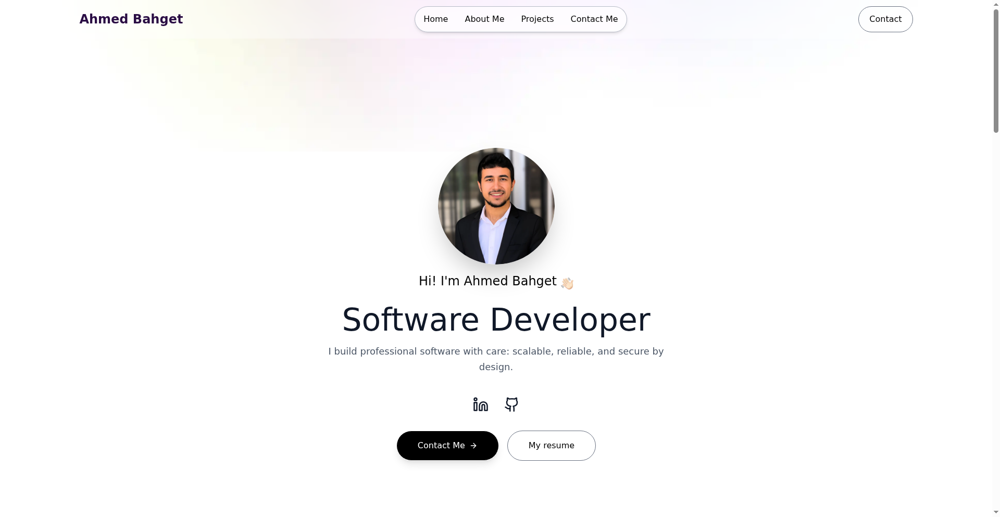

# Ahmed Bahget - Portfolio

**Live site:** https://my-portfolio-seven-beta-nhm0z5sij9.vercel.app



Personal portfolio built with **Next.js 15 (App Router)**, **React 19** and **Tailwind CSS 4**. It lists my projects with live demos and GitHub links, my background, and a contact section.

## Features

- Responsive layout (mobile menu, desktop nav)
- Light / dark theme with `next-themes`
- Animations with `motion`
- Project pages with live demo and source links
- Images served through Cloudinary (`next-cloudinary`)

## Tech stack

Next.js, React, Tailwind CSS, JavaScript, ESLint, deployed on Vercel. A GitHub Actions workflow runs ESLint on every push.

## Run locally

```bash
git clone https://github.com/Ahmed-bahget/my-portfolio.git
cd my-portfolio
npm install
npm run dev      # http://localhost:3000
```

Other scripts: `npm run lint`, `npm run build`, `npm start`.

## Other projects

- [socially](https://github.com/Ahmed-bahget/socially): social media app (Next.js, TypeScript, Prisma)
- [Jop-Portal](https://github.com/Ahmed-bahget/Jop-Portal): MERN job portal
- [Events-Sharing-App](https://github.com/Ahmed-bahget/Events-Sharing-App): React + TypeScript events app
